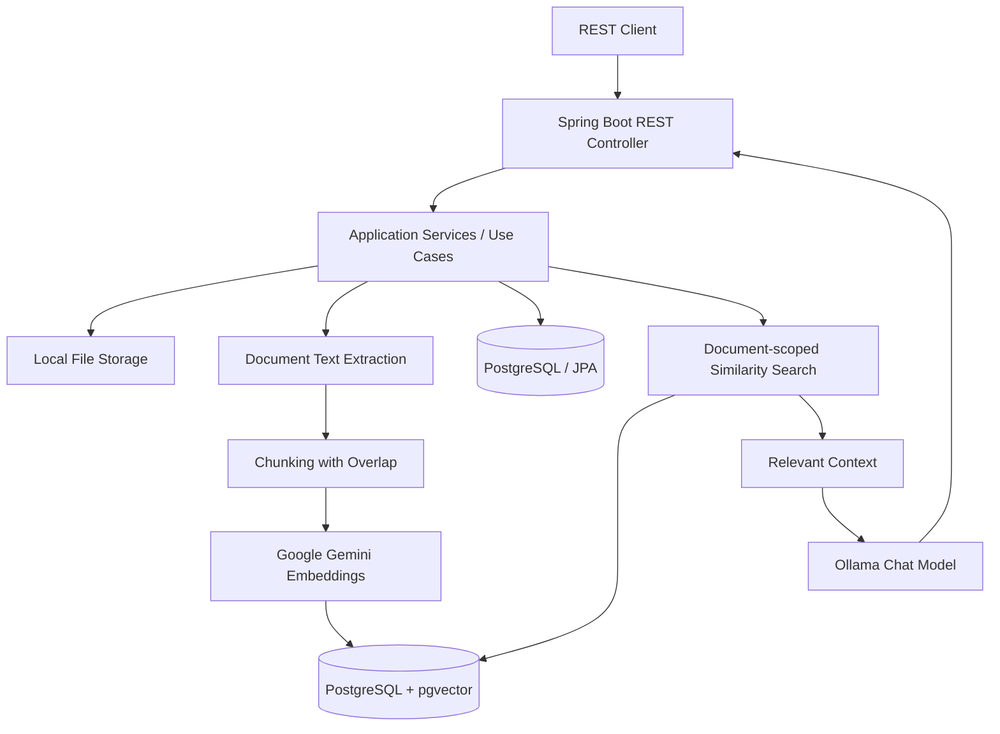

# DocuMind

**DocuMind** is a Java-based Retrieval-Augmented Generation (RAG) backend that lets users ask questions about uploaded documents. It extracts and chunks document text, generates embeddings with Google Gemini, stores vectors in PostgreSQL using pgvector, retrieves relevant passages, and uses a self-hosted Ollama model to generate context-grounded answers.

## Features

- Upload and manage PDF, TXT, and DOCX documents.
- Validate uploaded files, including file type and size (10 MB maximum).
- Extract text using Spring AI document readers (Tika/PDF).
- Split text into configurable chunks with overlap.
- Generate 768-dimensional embeddings using Google Gemini Embeddings (`gemini-embedding-001`).
- Store document metadata and chunks in PostgreSQL.
- Store and search vector embeddings with pgvector.
- Retrieve the top 5 relevant chunks scoped to the requested document.
- Generate answers using a locally hosted Ollama chat model.
- REST APIs for uploading, processing, listing, retrieving, asking questions, and deleting documents.
- API correctness, performance, and concurrent-load test programs.

## How the RAG pipeline works

1. **Upload:** the API validates the file, stores it, and saves document metadata.
2. **Extract and chunk:** the application extracts text and splits it into overlapping chunks.
3. **Embed and index:** Google Gemini generates embeddings; chunk text and metadata are indexed in PostgreSQL/pgvector.
4. **Retrieve:** a question is embedded and similarity search retrieves up to five relevant chunks belonging to the selected document.
5. **Generate:** the retrieved context and question are sent to the Ollama chat model to produce an answer.

## Architecture

The project follows a **Hexagonal Architecture (Ports and Adapters)** style. The presentation layer invokes application use cases. Application services depend on ports, while infrastructure adapters implement integrations such as persistence, file storage, document extraction, embeddings, vector search, and chat completion.



## Technology stack

| Area | Technology |
|---|---|
| Language | Java 21 |
| Backend | Spring Boot 4.2 |
| AI integration | Spring AI 2.0.1 |
| Embeddings | Google Gemini Embedding (`gemini-embedding-001`) |
| LLM inference | Ollama |
| Database | PostgreSQL 17 |
| Vector database extension | pgvector |
| Vector index / distance | HNSW / cosine distance |
| Persistence | Spring Data JPA, Hibernate |
| Document extraction | Spring AI PDF and Tika document readers |
| API testing | JUnit 5, REST Assured |
| Build | Maven |
| Local infrastructure | Docker Compose |

## Prerequisites

- Java 21
- Docker Engine and Docker Compose
- Google AI API key with access to the configured embedding model
- Ollama installed and running, with a chat model pulled
- Maven, or use the included Maven Wrapper

## Getting started

### 1. Clone the repository

```bash
git clone https://github.com/chauhan12harsh/Documind.git
cd Documind
```

### 2. Start PostgreSQL with pgvector

```bash
docker compose up -d postgres
docker compose ps
```

The Compose configuration starts `pgvector/pgvector:pg17`, creates the `documind` database, and exposes PostgreSQL on port `5432`. The current Compose file uses the local-development credentials `documind` / `local_dev_password`. Change these credentials for your environment and keep the datasource configuration in sync. Do not use the sample password in a deployed environment.

### 3. Configure the application

Create your local configuration from the example:

```bash
cp src/main/resources/application.example.yaml src/main/resources/application.yml
```

Update the datasource username/password and set your Google API key. The example configuration reads the key from the `GOOGLE_API_KEY` environment variable:

```bash
export GOOGLE_API_KEY="your-google-api-key"
```

Also configure:

- `ollama.base-url`: base URL where the Java application can reach Ollama (for example, `http://localhost:11434` for a local Ollama service).
- `ollama.chat-model`: the exact model name available in your Ollama installation.
- PostgreSQL datasource settings to match your database.

Do not commit `application.yml`, real API keys, or production credentials.

The example configuration sets the API port to `8000`, document storage to `./uploads`, chunk size to `1000`, overlap to `200`, and vector dimensions to `768`.

### 4. Start Ollama

Install and start Ollama, then pull a chat model. For example:

```bash
ollama pull qwen2.5:1.5b
```

If you use this model, set `ollama.chat-model: qwen2.5:1.5b` in your application configuration. Ensure the configured Ollama URL is reachable from the application host.

### 5. Run DocuMind

```bash
./mvnw spring-boot:run
```

On Windows:

```bat
mvnw.cmd spring-boot:run
```

The API listens on **http://localhost:8000** by default.

## REST API

The document endpoints are prefixed with `/api/v1/documents`.

| Method | Endpoint | Description |
|---|---|---|
| `POST` | `/api/v1/documents` | Upload a document (multipart field: `file`) |
| `GET` | `/api/v1/documents` | List documents |
| `GET` | `/api/v1/documents/{id}` | Retrieve document metadata |
| `POST` | `/api/v1/documents/{id}/process` | Extract, chunk, embed, and index a document |
| `POST` | `/api/v1/documents/{id}/ask` | Ask a question about a document |
| `DELETE` | `/api/v1/documents/{id}` | Delete a document and its associated data |

### Upload a document

```bash
curl -X POST http://localhost:8000/api/v1/documents \
  -F "file=@/path/to/document.pdf"
```

The upload response provides the document ID. Use it in the following requests.

### Process the document

```bash
curl -X POST http://localhost:8000/api/v1/documents/<DOCUMENT_ID>/process
```

### Ask a question

```bash
curl -X POST http://localhost:8000/api/v1/documents/<DOCUMENT_ID>/ask \
  -H "Content-Type: application/json" \
  -d '{"question":"What are the main points in this document?"}'
```

The request requires a non-blank question. The response contains the document ID, question, and generated answer.

### List documents

```bash
curl http://localhost:8000/api/v1/documents
```

### Retrieve a document

```bash
curl http://localhost:8000/api/v1/documents/<DOCUMENT_ID>
```

### Delete a document

```bash
curl -X DELETE http://localhost:8000/api/v1/documents/<DOCUMENT_ID>
```

## Configuration reference

| Property | Example | Purpose |
|---|---|---|
| `server.port` | `8000` | HTTP server port |
| `spring.datasource.url` | `jdbc:postgresql://localhost:5432/documind` | PostgreSQL connection |
| `spring.ai.google.genai.embedding.text.model` | `gemini-embedding-001` | Embedding model |
| `spring.ai.google.genai.embedding.text.dimensions` | `768` | Embedding dimensions |
| `spring.ai.vectorstore.pgvector.index-type` | `HNSW` | Vector index |
| `spring.ai.vectorstore.pgvector.distance-type` | `COSINE_DISTANCE` | Similarity distance |
| `ollama.base-url` | `http://localhost:11434` | Ollama endpoint |
| `ollama.chat-model` | `qwen2.5:1.5b` | Ollama model |
| `documind.storage.location` | `./uploads` | Uploaded file location |
| `documind.chunking.size` | `1000` | Chunk size |
| `documind.chunking.overlap` | `200` | Chunk overlap |

Keep the embedding model output dimension aligned with the pgvector dimension setting.

## Testing

Run the Maven test phase:

```bash
./mvnw test
```

The repository includes API-oriented test programs:

- **AskApiCorrectnessTest** — exercises question answering against expected document content.
- **AskApiPerformanceTest** — measures repeated API request latency.
- **AskApiLoadTest** — exercises concurrent requests and reports request success and latency metrics.

These tests call the running API at `http://localhost:8000` and rely on a sample document being available and processed. Start the application and its dependencies, and prepare the test document before running the API tests. They are not standalone unit tests.

## Project structure

```text
src/main/java/com/documind/
├── application/
│   ├── port/
│   │   ├── in/          # Input ports / use-case interfaces
│   │   └── out/         # Output ports for infrastructure
│   └── service/         # Application use cases and services
├── domain/
│   ├── enums/           # Domain enums
│   ├── exception/       # Domain exceptions
│   └── model/           # Document and DocumentChunk models
├── infrastructure/
│   ├── ai/              # Gemini embedding and Ollama chat adapters
│   ├── document/        # Document text extraction
│   ├── persistence/     # JPA entities, repositories, adapters
│   ├── storage/         # Local file storage adapter
│   └── vectorstore/     # pgvector adapter
└── presentation/
    ├── controller/      # REST controllers
    ├── dto/             # API request and response DTOs
    └── exception/       # API exception handling

src/test/java/com/documind/
    # API correctness, performance, and load tests
```

## License

This project is licensed under the [Apache License 2.0](LICENSE).
